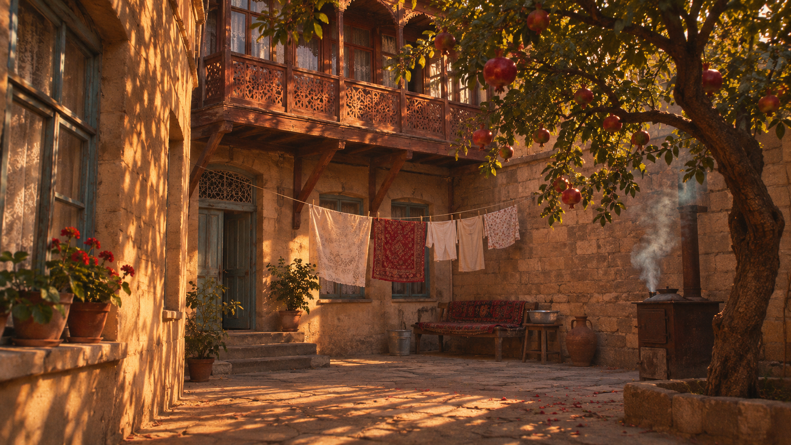
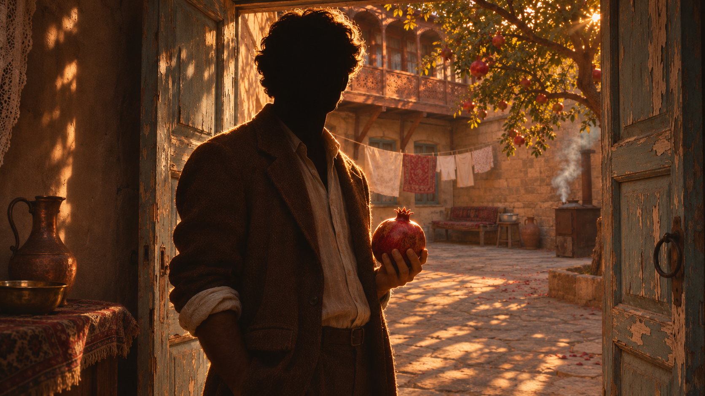
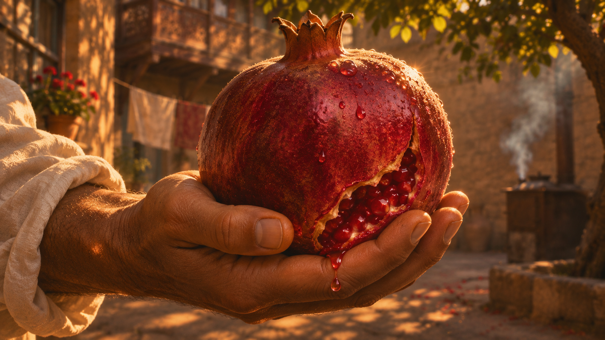
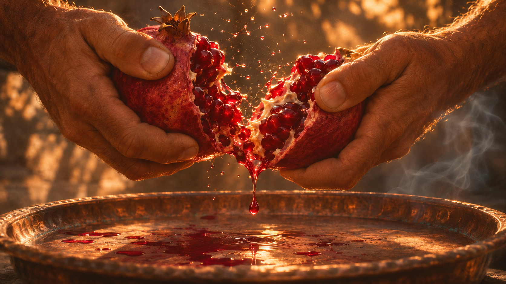
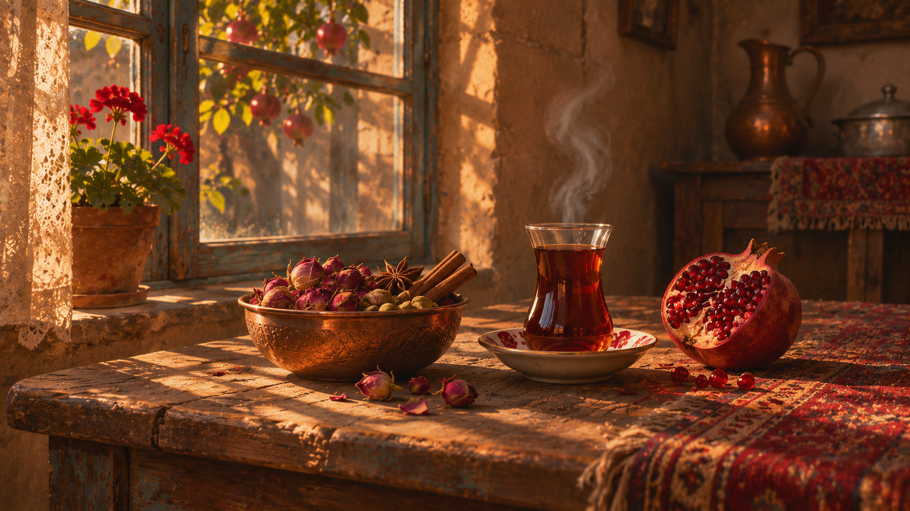
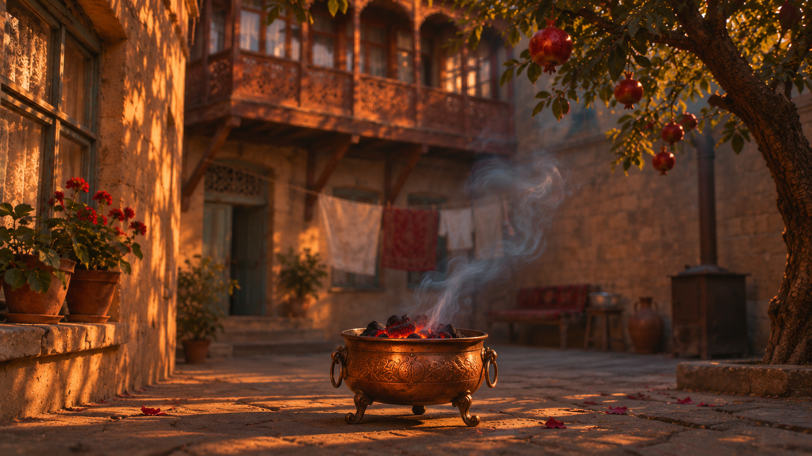
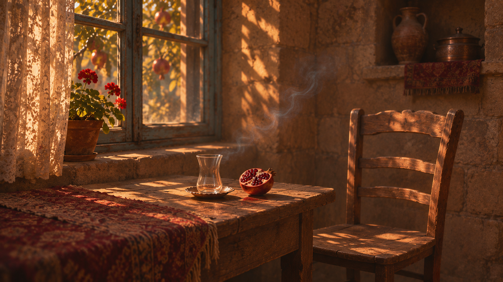
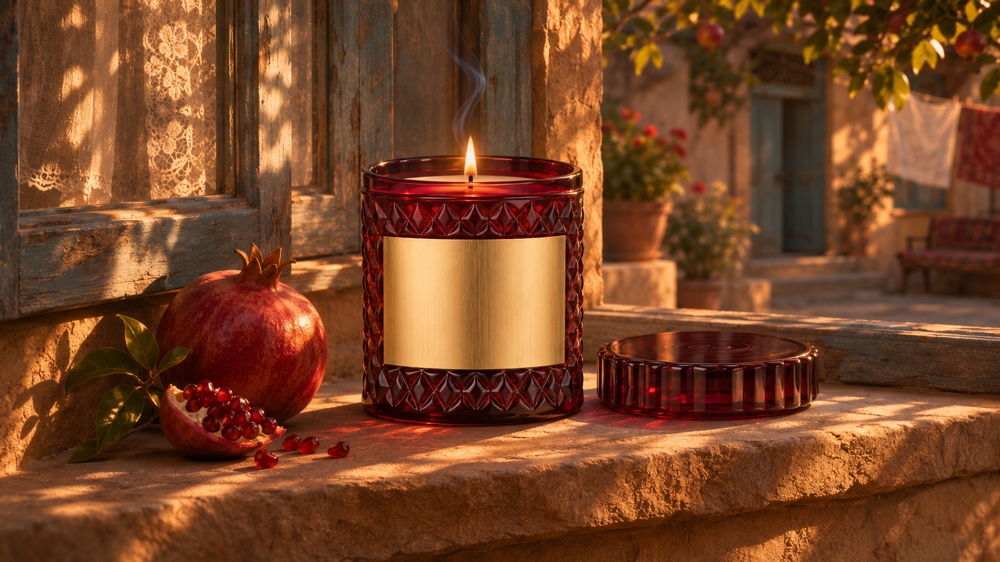

# Журнал генерации кадров Tonka

20 ноября 2026 · Smoky Pomegranate

Встроенный генератор изображений ImageGen в Codex. Восемь генераций, по одной на кадр. Все восемь результатов приняты после визуальной проверки.

Кадр 01 задан первым. Он служил референсом света, палитры и места действия для остальных кадров. Для кадра 14 первым референсом была фотография свечи 220 мл из материалов Tonka, вторым — кадр 01.

Самым требовательным был кадр 14. Сходство проверялось по форме, цвету и деталям стекла отдельно от освещения сцены.

Журнал содержит точные промпты, итоговые изображения и замечания визуальной проверки. Снимки интерфейса чата в комплекте отсутствуют.

## Кадр 01 — Двор



Общий план двора задал палитру, фактуру дерева и направление света.

```text
Use case: illustration-story. Tonka Smoky Pomegranate storyboard frame 01, a single full-bleed horizontal 16:9 cinematic still. Keep essential subjects in the central safe area for a 16:9 crop if needed. Wide shot from a child's eye level of a narrow old Baku courtyard, warm sandstone walls, a carved wooden balcony gallery on the upper floor, laundry hanging on a line, a pomegranate tree in the corner, long golden shadows across the worn stone floor, no people. Cinematic 35mm film still, golden hour, warm low sun, long soft shadows, subtle film grain, shallow depth of field, color palette of pomegranate red, deep wine, copper, ochre, sandstone and bluish-grey smoke, intimate, quiet, nostalgic, 1980s. No faces, no text, no logos, no flags. Authentic lived-in residential courtyard, quiet natural film color.
```

## Кадр 03 — Папа в дверях



Лицо закрыто тенью. Во дворе за дверью видны резной балкон и дерево из кадра 01.

```text
Same style, light and color as the attached image. Use case: illustration-story. Tonka Smoky Pomegranate storyboard frame 03, one full-bleed horizontal 16:9 still. Keep all essential subjects inside the central widescreen safe area. View from inside a dim old house: an old wooden door with peeling paint is open to a bright sunlit courtyard, a man stands in the doorway as a dark backlit silhouette against the low sun, his face completely in shadow and not visible, he wears a white linen shirt with rolled-up sleeves and a dark brown wool jacket, in one hand he holds a large ripe pomegranate. Cinematic 35mm film still, golden hour, warm low sun, long soft shadows, subtle film grain, shallow depth of field, color palette of pomegranate red, deep wine, copper, ochre, sandstone and bluish-grey smoke, intimate, quiet, nostalgic, 1980s. No faces, no text, no logos, no flags. Match the actual courtyard seen through the old weathered muted blue-grey door, seen from within. The face must be an unbroken dark silhouette with no discernible facial features. His white rolled linen sleeve may show underneath the open brown jacket. Show the whole pomegranate distinctly against rim light.
```

## Кадр 04 — Гранат на ладони



У основания граната видна трещина с зёрнами. Часть пальцев скрыта за плодом.

```text
Same style, light and color as the attached image. Use case: illustration-story. Tonka Smoky Pomegranate storyboard frame 04, one full-bleed horizontal 16:9 still. Keep all essential subjects inside the central widescreen safe area. Extreme macro of a large heavy ripe pomegranate resting on a man's strong tanned palm, the sleeve of a white linen shirt rolled up, the pomegranate skin has split open at the base revealing glossy ruby-red seeds, backlit by golden sun, droplets of juice glistening. Cinematic 35mm film still, golden hour, warm low sun, long soft shadows, subtle film grain, shallow depth of field, color palette of pomegranate red, deep wine, copper, ochre, sandstone and bluish-grey smoke, intimate, quiet, nostalgic, 1980s. No faces, no text, no logos, no flags. The fruit is a real large burgundy pomegranate with a recognizable intact shape, natural crown and a single jagged open split low on the visible side near the base. A single anatomically credible hand supports its full weight from beneath, thumb and four fingers only, with plausible occlusion. Match the warmth and tree-filtered sunlight of the courtyard.
```

## Кадр 05 — Разлом граната



Две руки разламывают плод над медным подносом. Капля читается на фоне подноса.

```text
Same style, light and color as the attached image. Use case: illustration-story. Tonka Smoky Pomegranate storyboard frame 05, one full-bleed horizontal 16:9 still. Keep all essential subjects inside the central widescreen safe area. Macro shot of a man's strong tanned fingers breaking a ripe pomegranate in half above an old copper tray, ruby juice splashing, droplets glowing in warm backlight, a single drop falling onto the copper. Cinematic 35mm film still, golden hour, warm low sun, long soft shadows, subtle film grain, shallow depth of field, color palette of pomegranate red, deep wine, copper, ochre, sandstone and bluish-grey smoke, intimate, quiet, nostalgic, 1980s. No faces, no text, no logos, no flags. Both anatomically credible adult hands pull two halves of one fruit apart with plausible grips and natural finger occlusion, two thumbs total, no duplicated digits. Make the lit drop over the copper tray legible. The camera frames only hands, fruit and tray. Maintain natural fruit anatomy.
```

## Кадр 07 — Чай



Стакан армуду с тёмным чаем, пар, сухая роза, специи и гранат.

```text
Same style, light and color as the attached image. Use case: illustration-story. Tonka Smoky Pomegranate storyboard frame 07, one full-bleed horizontal 16:9 still. Keep all essential subjects inside the central widescreen safe area. An old worn wooden kitchen table by a window, a small pear-shaped armudu glass of dark strong tea with rising steam on a saucer, a copper bowl with dried rose buds and whole spices, half of a ripe pomegranate beside it, warm sunlight streaming through the window. Cinematic 35mm film still, golden hour, warm low sun, long soft shadows, subtle film grain, shallow depth of field, color palette of pomegranate red, deep wine, copper, ochre, sandstone and bluish-grey smoke, intimate, quiet, nostalgic, 1980s. No faces, no text, no logos, no flags. One small clear traditional Azerbaijani pear-shaped armudu, visibly narrower at the waist, dark tea and subtle rising steam. Quiet interior of the same house, near its weathered wooden window, lit by the same low sunlight.
```

## Кадр 10 — Мангал во дворе



Сизый дым и угли на переднем плане, знакомый двор на заднем.

```text
Same style, light and color as the attached image. Use case: illustration-story. Tonka Smoky Pomegranate storyboard frame 10, one full-bleed horizontal 16:9 still. Keep all essential subjects inside the central widescreen safe area. The same old Baku courtyard at dusk, a small copper brazier with glowing charcoal embers, soft bluish-grey smoke rising slowly into the last golden light, sandstone walls and a carved wooden balcony in the background, no people. Cinematic 35mm film still, golden hour turning to dusk, warm low sun, long soft shadows, subtle film grain, shallow depth of field, color palette of pomegranate red, deep wine, copper, ochre, sandstone and bluish-grey smoke, intimate, quiet, nostalgic, 1980s. No faces, no text, no logos, no flags. Use the first courtyard for location continuity, especially the carved wood gallery, timeworn sandstone, stone paving and subdued wooden trim. Bring the small copper brazier with glowing coals into the central foreground and show the gallery gently out of focus. The last sunset edge gives way to cooler evening shadows.
```

## Кадр 13 — Пустой стул



Пустой стул, пустой армуду и половинка граната. Стул задан в этом кадре, поскольку кадр 09 входит в дополнительную серию.

```text
Same style, light and color as the attached image. Use case: illustration-story. Tonka Smoky Pomegranate storyboard frame 13, one full-bleed horizontal 16:9 still. Keep all essential subjects inside the central widescreen safe area. The same old wooden chair beside the worn wooden table, now empty with no jacket on it, on the table an empty armudu tea glass and half of a pomegranate, a thin trace of bluish-grey smoke slowly fading in a beam of warm evening light, quiet empty room, no people. Cinematic 35mm film still, late golden hour, warm low sun, long soft shadows, subtle film grain, shallow depth of field, color palette of pomegranate red, deep wine, copper, ochre, sandstone and bluish-grey smoke, intimate, quiet, nostalgic. No faces, no text, no logos, no flags. Set it inside the same stone house, with a worn modest wooden ladder-back chair beside the worktable near its weathered muted blue-grey wood window. Frame the unoccupied chair, empty glass, half pomegranate and fading wisp clearly. Quiet, absorbing late light.
```

## Кадр 14 — Свеча Tonka



Сверены цилиндрическая форма, тёмно-винное стекло, ромбовидная огранка, ребристая крышка и прямоугольная золотая этикетка. Этикетка оставлена чистой для оригинальной надписи в монтаже.

[Исходная фотография свечи 220 мл](../материалы/Арома%20свеча%20220%20мл.jpg)

```text
The candle must look exactly like the product in the first attached photo — same jar shape, same wine-red faceted glass, same gold label. Style and light like the second attached image. Use case: illustration-story. Tonka Smoky Pomegranate storyboard frame 14, one full-bleed horizontal 16:9 still. Keep all essential subjects inside the central widescreen safe area. The scented candle exactly as in the reference photo: a cylindrical jar of deep wine-red faceted crystal glass with a diamond-cut pattern, a wide brushed-gold rectangular label on the front, its ribbed wine-red glass lid removed and placed beside the jar. The candle stands on a warm sandstone windowsill next to a ripe pomegranate, it is lit with a small calm flame and a thin line of smoke rising from the wick, warm sunset light through the window makes the red glass glow, present day, quiet and intimate. Cinematic 35mm film still, golden hour, warm low sun, long soft shadows, subtle film grain, shallow depth of field, color palette of pomegranate red, deep wine, copper, ochre, sandstone and bluish-grey smoke. No people, no faces, no extra text, no flags. Frame the jar, its loose lid and the fruit together in the middle of the widescreen composition. Match the reference jar body proportions without the lid, approximately as wide as it is tall, with straight sides, a thick base, a diamond relief band above and below the single large brushed-gold rectangular faceplate, ribbed low-profile circular lid of matching diameter, and a rich deep burgundy transmission in the highlights. Retain the gold label shape and use a clean unlettered plate for the original typography to be placed in editing. Product retains its exact forms. Use warm carved sandstone and the weathered blue-grey wooden window of the house for a quiet, story-led composition.
```
